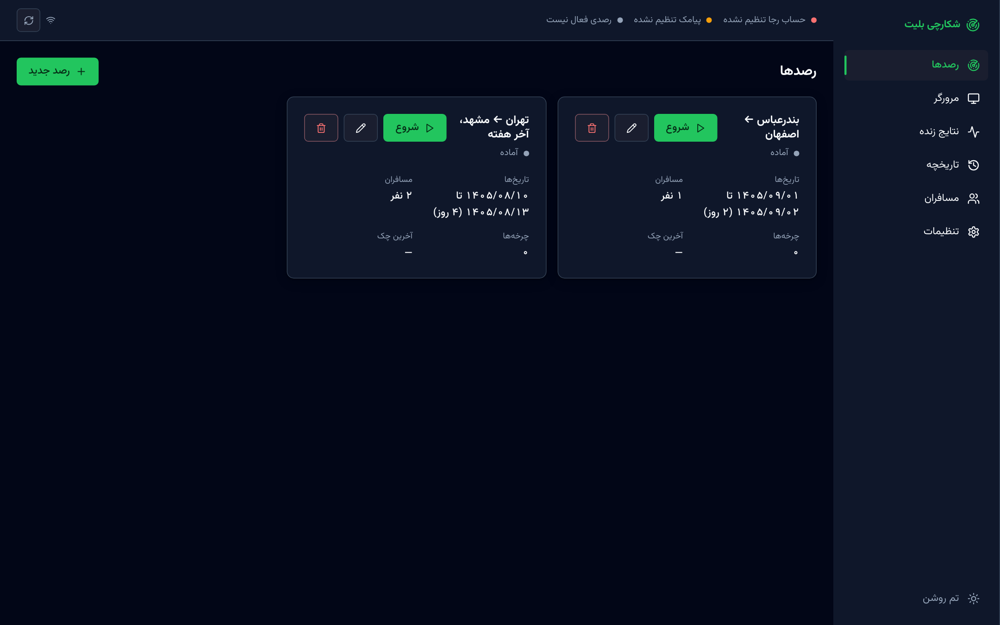
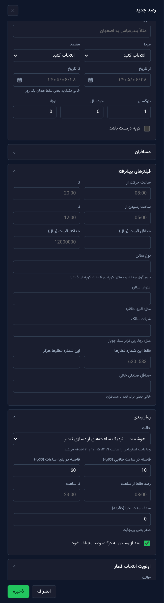
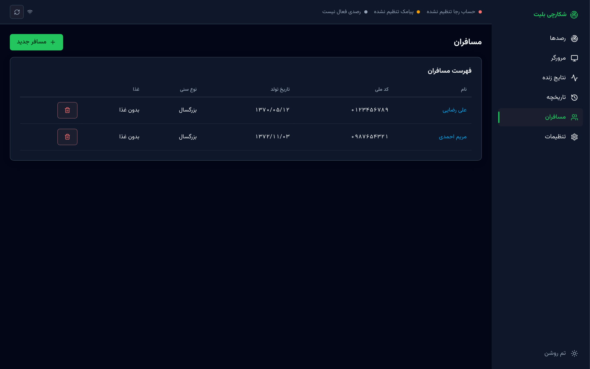
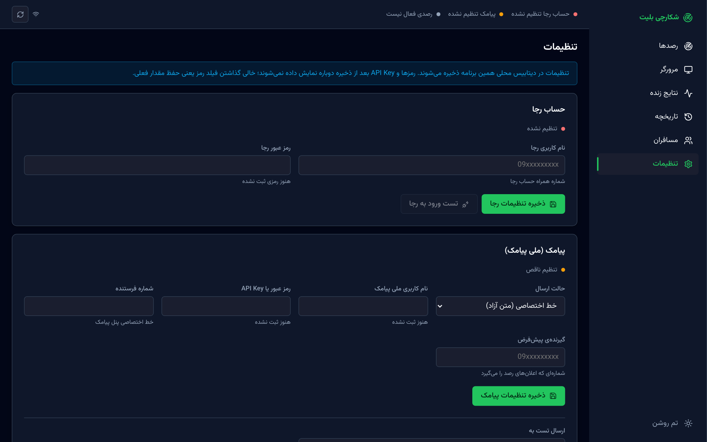
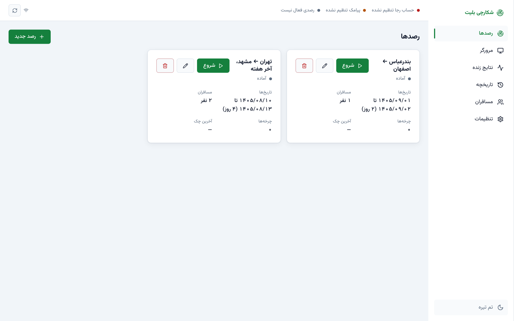
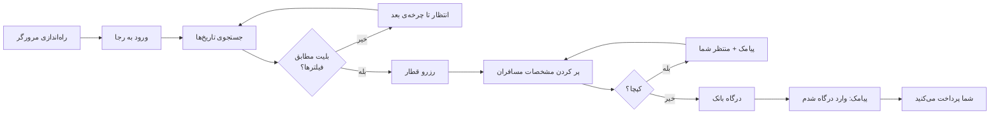

<div dir="rtl" align="right">

# شکارچی بلیت — Ticket Hunter (رجا)

رصد خودکار سایت [رجا](https://raja.ir) و پیش‌بردن خرید بلیت قطار **تا درگاه بانک**.
به‌محض پیدا شدن بلیتی که با فیلترهای شما بخواند، ربات مسافران را وارد می‌کند، به
صفحه‌ی پرداخت می‌رسد و با **پیامک** خبرتان می‌کند تا خودتان پرداخت را تمام کنید.

> ⚠️ ربات **هرگز پرداخت نمی‌کند** و **کپچا را حل نمی‌کند**؛ دقیقاً روی صفحه‌ی درگاه
> بانک می‌ایستد و منتظر شما می‌ماند.



## فهرست

- [این پروژه به چه دردی می‌خورد؟](#این-پروژه-به-چه-دردی-می‌خورد)
- [امکانات](#امکانات)
- [نگاهی به داشبورد](#نگاهی-به-داشبورد)
- [نصب و راه‌اندازی](#نصب-و-راه‌اندازی)
- [شروع سریع: اولین رصد](#شروع-سریع-اولین-رصد)
- [رصد چطور کار می‌کند؟](#رصد-چطور-کار-می‌کند)
- [تنظیمات](#تنظیمات)
- [معماری و ساختار پوشه‌ها](#معماری-و-ساختار-پوشه‌ها)
- [API داخلی](#api-داخلی)
- [توسعه و تست](#توسعه-و-تست)
- [عیب‌یابی](#عیب‌یابی)
- [خط قرمزها و مسئولیت استفاده](#خط-قرمزها-و-مسئولیت-استفاده)

## این پروژه به چه دردی می‌خورد؟

بلیت قطارهای پرتقاضا (آخر هفته، تعطیلات، مسیرهای شلوغ) خیلی زود تمام می‌شود، ولی
هر روز چند بار بلیت‌های **استردادی** دوباره به فروش می‌رسند. رجا خودش اعلام کرده
این بلیت‌ها حوالی ساعت‌های **۹، ۱۲، ۱۵، ۱۷ و ۱۹** به لیست برمی‌گردند و در چند ثانیه
خریداری می‌شوند.

شکارچی بلیت این کار خسته‌کننده را برایتان انجام می‌دهد:

1. مسیر و تاریخ‌های موردنظر را مرتب جستجو می‌کند،
2. نتایج را با فیلترهای شما (ساعت، قیمت، نوع سالن، شماره قطار، ظرفیت…) می‌سنجد،
3. اگر بلیتی پیدا شد، آن را رزرو می‌کند و فرم مسافران را پر می‌کند،
4. روی صفحه‌ی درگاه بانک می‌ایستد و **پیامک** می‌فرستد،
5. شما داخل همان داشبورد (یا هر جا که باشید) پرداخت را تمام می‌کنید.

## امکانات

- **رصد هم‌زمان چند مسیر و چند تاریخ**، با بازه‌ی تاریخ شمسی (مثلاً ۱۴۰۵/۰۸/۱۰ تا ۱۴۰۵/۰۸/۱۳)
- **زمان‌بندی هوشمند:** نزدیک ساعت‌های آزادسازی بلیت استردادی تندتر، بقیه‌ی روز آرام‌تر؛ یا فاصله‌ی ثابت
- **فیلتر دقیق:** بازه‌ی ساعت حرکت و رسیدن (حتی بازه‌های شبانه مثل ۲۲:۰۰ تا ۰۶:۰۰)، حداقل/حداکثر قیمت، نوع سالن، عنوان سالن، شرکت مالک، لیست سفید/سیاه شماره قطار، حداقل صندلی خالی
- **اولویت‌بندی نتایج:** «اولین موردِ مطابق» (سریع‌ترین) یا «جمع کن و بهترین را بردار» (ارزان‌ترین، نزدیک‌ترین به ساعت دلخواه، یا ترتیب دلخواه شماره قطارها)
- **پر کردن خودکار فرم مسافر** از پروفایل‌های ذخیره‌شده، و بازخوانی مقادیر پیش از رفتن به پرداخت (رجا ورودی نامعتبر را بی‌صدا پاک می‌کند!)
- **اطلاع‌رسانی پیامکی** با [ملی پیامک](https://melipayamak.com) (خط اختصاصی یا الگو/پترن)
- **مرورگر زنده داخل داشبورد:** مرورگر ربات همیشه headless است و تصویرش داخل پنل پخش می‌شود؛ حل کپچا و پرداخت نهایی هم همان‌جا انجام می‌شود
- **نوار پیشرفت مرحله‌به‌مرحله** (ورود ← جستجو ← فیلتر ← رزرو ← مسافران ← درگاه) با شمارش معکوس زنده
- **تقویم شمسی داخلی** و ارقام فارسی در تمام رابط
- **پشتیبانی از پروکسی** (چون رجا فقط از داخل ایران بالا می‌آید) همراه با دکمه‌ی تست
- **ماندگاری کامل در SQLite** و ادامه‌ی خودکار رصدها پس از ری‌استارت
- **رفتار محترمانه با سایت:** یک نشست، فاصله‌ی زمانی تصادفی (jitter) و backoff نمایی روی خطا
- داشبورد **فارسی، راست‌چین، با تم تیره و روشن**

## نگاهی به داشبورد

### ساخت رصد جدید

مسیر، بازه‌ی تاریخ، تعداد مسافران، فیلترهای پیشرفته، زمان‌بندی و اولویت انتخاب قطار
در یک کشوی بخش‌بخش (قابل جمع‌شدن) تنظیم می‌شوند. اعتبارسنجی همه‌جا سمت کلاینت و
با پیام فارسی است.

<p align="center">
  
</p>

### مسافران

پروفایل مسافران یک بار ثبت می‌شود و در هر رصد دوباره استفاده می‌شود. کد ملی، تاریخ
تولد، نوع سنی و گزینه‌ی غذا همان چیزی است که ربات در فرم رجا می‌نشاند.



### تنظیمات

حساب رجا، ملی پیامک و پروکسی همه از همین صفحه ثبت می‌شوند و در
SQLite محلی ذخیره می‌شوند. رمزها بعد از ذخیره هرگز دوباره نمایش داده نمی‌شوند.
دکمه‌های «تست ورود به رجا»، «تست پروکسی» و «ارسال پیامک تست» هم همین‌جاست.



### تم روشن



> داده‌ی نمایش‌داده‌شده در تصاویر کاملاً ساختگی است.

داشبورد صفحه‌های دیگری هم دارد: **مرورگر** (نمای زنده‌ی مرورگر ربات برای کپچا و
پرداخت)، **نتایج زنده** (جدول بلیت‌های دیده‌شده در آخرین چرخه‌ها و لاگ زنده‌ی ربات) و
**تاریخچه** (تایم‌لاین چرخه‌های هر رصد).

## نصب و راه‌اندازی

### پیش‌نیازها

| مورد | توضیح |
|---|---|
| Node.js ۲۰ یا بالاتر | برای اجرای سرور و ساخت داشبورد |
| حساب کاربری رجا | شماره‌ی همراه و رمز عبور |
| دسترسی به رجا از داخل ایران | از خارج ایران رجا باز نمی‌شود؛ در این حالت پروکسی تنظیم کنید |
| (اختیاری) حساب ملی پیامک | برای اطلاع‌رسانی پیامکی |

### نصب

```bash
git clone https://github.com/hoomanjamshidi/Ticket-Hunter-Raja.git
cd Ticket-Hunter-Raja

npm install            # پکیج‌ها + دانلود Chromium مربوط به Playwright
npm run build          # ساخت داشبورد
npm start              # http://127.0.0.1:4317
```

سپس <http://127.0.0.1:4317> را در مرورگر باز کنید.

> پوشه‌ی `data/` (دیتابیس، پروفایل مرورگر، اسکرین‌شات‌ها) خودکار ساخته می‌شود و
> در گیت نیست. اطلاعات حساب شما فقط روی همین دستگاه می‌ماند.

### فایل `.env` (اختیاری)

فقط برای گزینه‌های راه‌اندازی سرور است؛ حساب‌ها از صفحه‌ی «تنظیمات» ثبت می‌شوند.

```bash
cp .env.example .env
```

| متغیر | پیش‌فرض | توضیح |
|---|---|---|
| `PORT` | `4317` | پورت سرور |
| `LOG_LEVEL` | `info` | سطح لاگ |

## شروع سریع: اولین رصد

1. **تنظیمات ← حساب رجا:** شماره‌ی همراه و رمز را وارد و ذخیره کنید، بعد «تست ورود به رجا» را بزنید.
2. **تنظیمات ← پیامک (اختیاری):** اطلاعات ملی پیامک و شماره‌ی گیرنده را ثبت کنید و پیامک تست بفرستید.
3. **مسافران:** حداقل یک مسافر با مشخصات دقیق ثبت کنید (کد ملی ۱۰ رقمی، تاریخ تولد شمسی).
4. **رصدها ← رصد جدید:** مبدا، مقصد، بازه‌ی تاریخ و تعداد مسافران را بدهید، مسافران را انتخاب کنید، فیلترها را در صورت نیاز بگذارید و ذخیره کنید.
5. **شروع** را بزنید و نوار پیشرفت را دنبال کنید.
6. وقتی پیامک «وارد درگاه پرداخت شدم» آمد، به بخش **مرورگر** بروید و پرداخت را خودتان تمام کنید.

> **توصیه:** با تاریخ‌های کم (۱ تا ۳ روز) شروع کنید؛ [محدودیت نرخ درخواست رجا](#عیب‌یابی) را جدی بگیرید.

## رصد چطور کار می‌کند؟



### چرا درون مرورگر؟

رجا یک اپ Angular است و **payload هر درخواستش پیش از ارسال سمت کلاینت رمز می‌شود**؛
پس ساختن یک HTTP client مستقل شدنی (و پایدار) نیست. همه‌چیز داخل یک **مرورگر
واقعی (Playwright + Chromium)** اجرا می‌شود و صفحه‌ی نتایج با URL مستقیم باز می‌شود.

### زمان‌بندی

| حالت | رفتار |
|---|---|
| `smart` (پیش‌فرض) | در «ساعت‌های طلایی» (۹، ۱۲، ۱۵، ۱۷، ۱۹ با پنجره‌ی ±۲ دقیقه) هر ۱۰ ثانیه، در بقیه‌ی ساعت‌ها هر ۶۰ ثانیه |
| `fixed` | فاصله‌ی ثابت (پیش‌فرض ۳۰ ثانیه) با کمی jitter |

گزینه‌های بیشتر: بازه‌ی ساعتی فعال بودن رصد، سقف مدت اجرا، و توقف رصد پس از رسیدن به درگاه.

### فیلترها

| فیلتر | نمونه |
|---|---|
| ساعت حرکت / رسیدن | ۱۸:۰۰ تا ۲۳:۵۹ — بازه‌ی شبانه هم پشتیبانی می‌شود |
| قیمت (ریال) | حداکثر ۱۲٬۰۰۰٬۰۰۰ |
| نوع سالن | `کوپه ای 4 نفره` (شامل بودن، چند مورد با ویرگول) |
| عنوان سالن | `البرز`، `طلائیه` |
| شرکت مالک | `رجا`، `ریل ترابر سبا` |
| شماره قطار | فقط این‌ها / هرگز این‌ها |
| حداقل صندلی خالی | پیش‌فرض: برابر تعداد مسافران (رزرو ناقص به درد نمی‌خورد) |

### اولویت انتخاب

- **firstFound:** اولین قطاری که فیلترها را پاس کرد؛ سریع‌ترین حالت
- **priority:** همه را جمع می‌کند و بر اساس معیار بهترین را برمی‌دارد: `cheapest` (ارزان‌ترین)، `closestToTime` (نزدیک‌ترین به ساعت دلخواه) یا `trainOrder` (ترتیب دلخواه شماره قطارها)

### پیامک‌ها

| رویداد | محتوا |
|---|---|
| رسیدن به درگاه | شماره قطار، مسیر، تاریخ، ساعت و مبلغ + راهنمای رفتن به بخش «مرورگر» |
| نیاز به کپچا | تاریخ سفر + درخواست حل کپچا در پنل |

دو حالت ارسال پشتیبانی می‌شود:

- **خط اختصاصی (متن آزاد):** `SendSimpleSMS2`؛ همه‌ی جزئیات را می‌فرستد ولی اگر شماره در لیست سیاه مخابرات باشد نمی‌رسد.
- **الگو (Pattern):** `SendByBaseNumber`؛ به لیست سیاه هم می‌رسد و برای اعلان حیاتی «ورود به درگاه» مطمئن‌تر است. متن الگو را باید در پنل ملی پیامک ثبت و تأیید کنید و تعداد/ترتیب متغیرها باید با قالب برنامه بخواند.

### کپچا

در مسیر عادی با حساب واردشده کپچایی ظاهر نمی‌شود. اگر ظاهر شد، ربات **حلش نمی‌کند**:
متوقف می‌شود، پیامک می‌دهد، منتظر می‌ماند تا شما در نمای مرورگر پنل آن را حل کنید و بعد ادامه می‌دهد.

## تنظیمات

همه از صفحه‌ی **تنظیمات** پنل ثبت می‌شوند:

| بخش | فیلدها |
|---|---|
| حساب رجا | نام کاربری (شماره‌ی همراه) و رمز عبور |
| ملی پیامک | حالت ارسال، نام کاربری، رمز یا API Key، شماره‌ی فرستنده، شناسه‌ی الگو (Body ID)، شماره‌ی گیرنده‌ی پیش‌فرض |
| پروکسی | آدرس (`http://host:port` یا `socks5://host:port`)، نام کاربری و رمز |

> نصب‌های قدیمی که تنظیماتشان در `.env` بود، در اولین اجرا یک‌بار به SQLite منتقل می‌شوند.

## معماری و ساختار پوشه‌ها

```
src/
  raja/      ← هر چیزی که با سایت رجا حرف می‌زند (Playwright)
  hunter/    ← منطق رصد: زمان‌بندی، فیلتر، اولویت‌بندی، حلقه‌ی اصلی
  notify/    ← ملی پیامک: ارسال، قالب پیام‌ها، نگاشت خطاها به فارسی
  server/    ← Fastify: REST + WebSocket + سرو داشبورد
  db/        ← SQLite (better-sqlite3)
  config/    ← مدل داده (zod) و تنظیمات اجرایی
  utils/     ← تاریخ شمسی، ارقام فارسی، لاگر
web/         ← داشبورد React + Vite (RTL، فونت وزیرمتن)
scripts/     ← اسکریپت‌های تست دستی: ورود، جستجو، پیامک
test/        ← تست‌های واحد
data/        ← دیتابیس، پروفایل مرورگر، اسکرین‌شات‌ها (در گیت نیست)
```

**فناوری‌ها:** TypeScript، Node.js، Playwright، Fastify، SQLite، React، Vite، zod.

### قانون طلایی

هیچ سلکتور DOM ای بیرون از [`src/raja/selectors.ts`](src/raja/selectors.ts) نوشته
نمی‌شود. سایت رجا تنها نقطه‌ی شکست بیرونی است؛ وقتی ظاهرش عوض شود فقط همان یک
فایل باید اصلاح شود.

### نکته‌های فنی مهم

- **مرورگر درون‌برنامه‌ای:** با CDP (`Page.startScreencast`) فریم‌های JPEG گرفته و روی `/ws/browser` به داشبورد استریم می‌شود؛ کلیک و تایپ کاربر از همان کانال برمی‌گردد.
- **چند تاریخ هم‌زمان:** صفحه‌ی `/search?...` داخل یک iframe هم‌مبدأ رندر و DOM آن خوانده می‌شود، بی‌آنکه تب اصلی جابه‌جا شود.
- **قفل جامانده‌ی پروفایل کروم:** اگر برنامه ناگهانی بسته شود، اجرای بعد خودش قفل را پاک می‌کند.
- **خاموش شدن تمیز:** رصدهای `running` در دیتابیس همان‌طور می‌مانند و در اجرای بعد خودکار ادامه می‌یابند.

جزئیات کامل رفتار سایت رجا (آدرس‌ها، سلکتورها، تله‌های فرم مسافر، محدودیت نرخ درخواست) و
درس‌های آزمایش زنده در [CLAUDE.md](CLAUDE.md) آمده است.

## API داخلی

سرور روی `127.0.0.1` گوش می‌دهد.

| متد | مسیر | کار |
|---|---|---|
| GET | `/api/stations` | فهرست ایستگاه‌ها |
| GET / PUT | `/api/settings` | خواندن و ذخیره‌ی تنظیمات (رمزها بازگردانده نمی‌شوند) |
| POST | `/api/settings/test-raja` | تست ورود به رجا |
| POST | `/api/settings/test-proxy` | تست پروکسی |
| POST | `/api/settings/test-sms` | ارسال پیامک تست |
| GET / POST | `/api/passengers` | فهرست / افزودن مسافر |
| PUT / DELETE | `/api/passengers/:id` | ویرایش / حذف مسافر |
| GET / POST | `/api/watches` | فهرست / ساخت رصد |
| PUT / DELETE | `/api/watches/:id` | ویرایش / حذف رصد |
| POST | `/api/watches/:id/start` · `/stop` | شروع / توقف رصد |
| GET | `/api/watches/:id/runs` · `/offers` | چرخه‌ها و بلیت‌های دیده‌شده |
| WS | `/ws/browser` | تصویر زنده و ورودی مرورگر |

## توسعه و تست

```bash
npm run dev            # سرور با watch
npm run web:dev        # داشبورد روی پورت 5317 با پراکسی به سرور
npm run dev:login      # تست دستی ورود به رجا
npm run dev:search     # تست دستی جستجو و پارس نتایج
npm run dev:sms        # تست دستی پیامک
npm run typecheck      # بررسی تایپ
npm test               # تست‌های واحد
```

قواعد کدنویسی: TypeScript strict و بدون `any`؛ ارقام فارسی/عربی همیشه با
`utils/persianDigits.ts` نرمال شوند؛ تبدیل تاریخ شمسی فقط در `utils/jalali.ts`؛ رنگ‌های
داشبورد فقط از توکن‌های `web/src/theme.css`.

## عیب‌یابی

| مشکل | علت و راه‌حل |
|---|---|
| «خطا در اتصال سرویس» یا نتایج مدام خالی | رجا درخواست‌های پشت‌سرهم را محدود می‌کند (حدود ۸ تا ۱۲ بارگذاری پشت‌سرهم). تعداد تاریخ‌ها را کم یا فاصله را بیشتر کنید. برنامه خودش با هر خطای پیاپی فاصله را دو برابر می‌کند (تا سقف ۵ دقیقه). |
| «تعداد درخواست‌های شما بیش از تعداد مجاز می‌باشد» | همان محدودیت نرخ است؛ چند دقیقه صبر کنید. |
| فهرست ایستگاه‌ها خطای ۴۰۳ می‌دهد یا رجا باز نمی‌شود | رجا از خارج ایران در دسترس نیست؛ در تنظیمات پروکسی ایران بدهید و «تست پروکسی» را بزنید. |
| مرورگر باز می‌شود ولی هیچ اتفاقی نمی‌افتد | قفل جامانده‌ی پروفایل کروم؛ برنامه را ببندید و دوباره اجرا کنید (قفل خودکار پاک می‌شود). |
| پیامک نمی‌رسد (کد ۳۵) | شماره در لیست سیاه مخابرات است؛ حالت ارسال را روی «الگو» بگذارید. |
| خطای -۵ در پیامک الگو | تعداد/ترتیب متغیرهای الگوی ثبت‌شده در ملی پیامک با برنامه نمی‌خواند. |
| ربات با فرم مسافر ناقص جلو نمی‌رود | رجا کد ملی یا تاریخ تولد نامعتبر را بی‌صدا پاک می‌کند؛ مشخصات مسافر را بررسی کنید. |

## خط قرمزها و مسئولیت استفاده

- **کپچا حل نمی‌شود.** ربات متوقف می‌شود، پیامک می‌دهد و منتظر کاربر می‌ماند.
- **پرداخت انجام نمی‌شود.** ربات دقیقاً روی صفحه‌ی درگاه بانک می‌ایستد.
- **رمزها هرگز لاگ یا در پاسخ API نمایش داده نمی‌شوند.** اعتبارنامه‌ها فقط در SQLite محلی شما ذخیره می‌شوند.
- با سایت محترمانه رفتار کنید: یک نشست، فاصله‌ی معقول بین درخواست‌ها، تعداد کم تاریخ.
- این پروژه ابزاری مستقل است و هیچ ارتباطی با شرکت رجا ندارد. استفاده از آن **با مسئولیت خود شماست** و ممکن است با شرایط استفاده‌ی سایت مغایرت داشته باشد؛ ظاهر سایت هم هر زمان ممکن است تغییر کند و رصد را بشکند.

</div>
